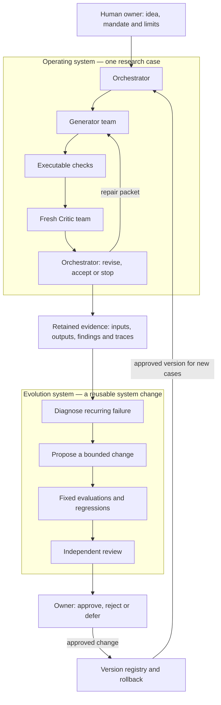

# Topic 3: proposed three-section design

Status: design for discussion, 6 November 2026. The slide sources and PDFs have
not been rearranged by this proposal. Current-page references use the 50-page
English PDF at commit `7e125eb`, including the title page.

## Teaching sequence and page budget

The lecture follows one task: build an agentic quant research system, explain
the engineering choices, and improve the system using evidence from its runs.
The opening shows the complete destination, including evolution. Section 2
explains reusable mechanisms. Section 3 constructs and exercises those mechanisms
in QT. One synthetic monthly-momentum case connects all three sections.

| Part | Proposed pages | Count |
|---|---:|---:|
| Title and engineering ladder | 1–2 | 2 |
| 1. Introduction | 3–8 | 6 |
| 2. Design of Long-Run Workflows: roadmap | 9 | 1 |
| 2.1 Harness | 10–15 | 6 |
| 2.2 Loop | 16–20 | 5 |
| 2.3 Graph | 21–25 | 5 |
| 2.4 Evolution | 26–30 | 5 |
| 3. Case: The Quant System: roadmap | 31 | 1 |
| 3.1 Build | 32–41 | 10 |
| 3.2 Evolve | 42–49 | 8 |
| Final system review | 50 | 1 |
| Total | 1–50 | 50 |

Page 2 also previews the three sections. Pages 9 and 31 provide the section
roadmaps; subsection starts use a compact location marker within their content
pages. This preserves the user's explicit opening page numbers without adding
seven separate subsection-divider slides.

Working assumption pending discussion: teach evolution of prompts, skills,
tools and orchestration as a general architecture, while demonstrating the
currently implemented QT Generator-prompt change. Broader runtime evolution
requires its own scoped implementation and evaluations. It is not already
implemented by the current prompt-version interface.

## Opening: pages 1–8

| Page | Proposed title | What appears on the slide | Current material |
|---:|---|---|---|
| 1 | Long-Run Workflows: Harness, Loop, and Graph | Existing title and course identity. Evolution is the system-improvement theme developed through the lecture. | 1 |
| 2 | The Engineering Ladder | Reuse Topic 2 page 2. Add a labelled outline enclosing the upper harness platform and loop/graph pillars: “This Lecture: Harness, Loop, and Graph Engineering.” Keep prompt/context below as prior material. | Topic 2 page 2; new highlight |
| 3 | Building the Agentic Quant System | State the deliverable: a trading idea and dated inputs produce a strategy, executable checks, independent review, and retained evidence. Show the acceptance tests: trace, reproduce, resume, restore. | 2 + 4 |
| 4 | The Complete System: Research and Evolution | First view of the operating system, evidence store, evolution system, version registry and human decision points. Show feedback into later runs. | 30 + 29 + 45; redrawn overview |
| 5 | Finance Requirements: Evidence and Authority | Auditor: reconstruct inputs, versions and reasoning evidence. Risk manager: identify the authorized action, approver and limits. Connect each need to one concrete artifact/control. | Auditor/risk half of 6; relevant parts of 27 |
| 6 | Finance Requirements: Continuity and Change | Operations: resume from verified state after interruption. System owner: demonstrate that a change helps while retaining existing controls and a way back. | Operations/owner half of 6 |
| 7 | Finance: What the System Must Demonstrate | Six-row synthesis: reliable calculations; reproducibility and replay; temporal validity; action authority; accountable evidence; controlled change. Show the financial consequence and engineering response for each. | New sourced synthesis; existing finance-source notes |
| 8 | Division of Labor | Keep the current human/system diagram. People set the idea/design and decide capital use; agents propose/review; executable code computes, checks and routes. | 3 |

The page-2 highlight should enclose the existing upper engineering area. A new
box floating above the ladder could imply an additional engineering rung, which
would conflict with the original diagram's platform-and-pillars explanation.
Evolution is introduced on page 4 as feedback that changes a version of the
system, rather than another rung.

### Page 4 architecture

Use three visual bands: operating workflow, retained evidence/version state,
and evolution workflow. Keep human policy ownership and approval explicit.
The first view shows the main roles; page 23 expands the specialist teams and
join barriers so the original architecture's details remain taught.

The diagram must communicate these boundaries:

- The inner loop changes a strategy candidate; the outer loop changes a reusable
  system version. They have different request IDs, artifacts and acceptance tests.
- Evidence flows out of completed research cases. Approved versions flow into
  future cases. Existing cases retain the configuration under which they began.
- Evolution proposals use Generator and fresh Critic teams too. Their specialist
  tasks become diagnosis, change design and test design, then evidence,
  regression and scope review; they are not an unreviewed self-editing branch.
- Rejecting or deferring an evolution proposal leaves the active version in place.
  Rollback restores a retained approved version and is checked in a new case.
- Acceptance of research, adoption of a system version and authorization to use
  capital are separate decisions. The diagram grants no brokerage authority.

### Page 7: proposed comparison content

The comparison should show how shared engineering requirements become concrete
in finance. Reliability and reproducibility also matter in software, healthcare
and other consequential applications; do not claim finance has exclusive needs.

| Requirement | Financial consequence | Engineering response |
|---|---|---|
| Reliability | Wrong values or exposures affect decisions | Numerical checks and independent review |
| Reproducibility and replay | A past decision must be examinable | Frozen inputs/code/configuration; retained actions |
| Temporal validity | Future information can contaminate research | Release-time versions and execution timing |
| Action authority | An action may spend money or change exposure | Mandate, limits and bound approval |
| Accountability | Someone must own decisions and exceptions | Evidence lineage and named responsibility |
| Controlled change | One update affects many later cases | Held-out evaluation, versions and rollback |

Use “reproducibility” precisely: distinguish reconstructing an actual past run,
recomputing deterministic financial results, and evaluating a fresh model run.
The last may follow a different path or use different wording. Repeated answers
or matching hashes alone do not establish financial correctness.

Source support checked on 6 November 2026:

- [FINRA 2026 Annual Regulatory Oversight Report, printed pp. 24–27](https://www.finra.org/sites/default/files/2025-12/2026-annual-regulatory-oversight-report.pdf): supports attention to accuracy, testing, oversight, scope/authority, sensitive data, recorded actions and model-version monitoring. This is a US broker-dealer example; the report does not prescribe this QT architecture or create new requirements.
- [MAS, Safeguards for Agentic Finance at Runtime](https://www.mas.gov.sg/publications/monographs-or-information-paper/2026/safeguards-for-agentic-finance-at-runtime) and its [reference paper](https://www.mas.gov.sg/-/media/mas-media-library/development/fintech/ai-safr/safr-v1-1.pdf): proposes runtime action authorization, calibrated human involvement and decision records. Present it as an industry reference approach.
- [NIST AI RMF 1.0, section 3](https://nvlpubs.nist.gov/nistpubs/ai/NIST.AI.100-1.pdf): reliability, resilience and accountability apply across AI domains and must be assessed in context.
- [Existing finance-harness source notes](../notes/2026-11-03-topic3-finance-harness-sources.md), current PIT/calculation examples and the QT tests supply the course-specific temporal and replay examples. The six-row table is a teaching synthesis, not a quoted regulatory checklist.

Git records version history. An approver name in Git metadata alone is not an
approval mechanism: the approval record must identify the authorized action or
version. Preserve the original JSON/Git/controller/state-machine examples while
making this distinction on page 5.

## Section 2: Design of Long-Run Workflows

These four subsections answer different design questions. The same component
can participate in more than one: a checkpoint is a harness facility, while
the loop decides whether to retry and the graph decides which downstream nodes
are invalidated. Evolution changes an approved configuration of those mechanisms.

| Subsection | Design question | Artifact students should be able to specify |
|---|---|---|
| 2.1 Harness | What surrounds the model and controls its work? | Task/tool contract, permissions, state and evidence record |
| 2.2 Loop | What repeats, what changes, and when does it end? | Transition, retry and stopping rules |
| 2.3 Graph | Who does what, what can run together, and how does work pass? | Role/dependency graph with typed handoffs and joins |
| 2.4 Evolution | How can the system itself improve without losing control? | Versioned change proposal, evaluation and adoption record |

| Page | Subsection and proposed title | Content and exhibit | Current material |
|---:|---|---|---|
| 9 | Design Roadmap | Highlight Harness, Loop, Graph and Evolution within the three-section lecture. | Replace old navigation |
| 10 | Harness: The Controlled Environment | Existing harness diagram: context, agent, tools, durable state, output gate and return artifact. Locate model reasoning inside it. | 8 |
| 11 | Harness: Mandate and Contracts | Preserve the monthly-momentum request, frozen data/costs, workspace access and no broker access. Add a compact input/output contract with completion and failure outcomes. | 9; clearer contract exhibit |
| 12 | Harness: Dated Inputs and Verified Calculations | Retain both worked exhibits: the restatement/PIT timeline and the momentum calculation, 21 closing prices and stable tie-break. Connect availability checks to known-answer verification. | 7 + 10 |
| 13 | Harness: Permissions and Untrusted Inputs | Treat retrieved instructions as data; enforce host restrictions. Keep the paid-data request example, supplier/purpose/budget/expiry/approver checks and the AP2 reference. | 26 + 25 |
| 14 | Harness: Hooks and Gates | Event-triggered observation versus host-supported blocking; controller remains responsible for acceptance. Use the event → hook → gate diagram. | 20 |
| 15 | Harness: State, Provenance and Checkpoints | Completed/pending/uncertain state; case/request/candidate/prompt IDs; role/round/retries/deadline; artifact paths/hashes; open findings. Show the evidence links that later enable audit replay. | 22 + evidence-record portion of 24 |
| 16 | Loop: Act, Observe, Decide | Tool loop, failure observation, bounded retry and continuation. State what is updated after each observation. | 11 |
| 17 | Loop: Generate, Check, Critique | Research revision diagram with independent review. Retain the “costs included / costs not deducted” counterexample as a callout. Preserve the limits of independent contexts and fixed mandate/acceptance rules. | 18 + 12 |
| 18 | Loop: Findings and Verified Repairs | Keep the same-close timing exercise and the `pit-001` ledger example. Omission never closes a finding; repair needs evidence verified by the Critic. | 17; exercise |
| 19 | Loop: Acceptance, Budgets and Stop Rules | Same candidate/two clean full reviews is QT's policy; repair while progress and budget remain; rejection, blocking, exhaustion, stalling and user stop remain distinct. | 19 |
| 20 | Loop: Recovery and Safe Retry | Inspect completion after timeout; return actionable submission errors; investigate altered evidence; reconcile uncertain side effects; resume only verified pending work. | 23 + recovery aspects of 22/37 |
| 21 | Graph: Dependencies and Handoffs | Nodes perform tasks, edges require satisfied inputs. Show forward dependencies and conditional repair routes; explain that feedback makes the whole workflow cyclic. | 14 |
| 22 | Graph: Orchestrator and Authority | Main agent coordinates; controller validates transitions. Generator/Critic cannot grant themselves permissions or bypass gates. | 13 |
| 23 | Graph: Teams, Fan-Out and Joins | Expand the page-4 overview into the full Generator and Critic teams: data/features/backtest and PIT/robustness/execution. Wait for all reports and integrate evidence before routing. | 15 + detailed operating architecture from 30 |
| 24 | Graph: Artifact Contracts and State Ownership | New explicit handoff exhibit: request ID, candidate/version, status, evidence path/hash, findings. Workers return artifacts; the controller owns shared state. Define joining and conflict handling. | Extend 22/35/36 with a focused design page |
| 25 | Graph: Combined Results and Shared Limits | Preserve the two-proposals/aggregate-exposure example and the fixture limitation. Explain why local passes do not imply a valid combined result. | 16 |
| 26 | Evolution: Candidate Versus System | Retain the three-loop distinction and recurring-timing-failure example. Define what changes in a tool iteration, research revision and system update. | 28 |
| 27 | Evolution: The Outer Improvement Loop | Capture → diagnose → propose → evaluate → review/decide → versioned adoption. Show evidence and version feedback to the operating system; mark current QT prompt scope. | 29; full-system context from 4 |
| 28 | Evolution: Evaluation and Regression | Preserve parseability, actual timing, evidence support and authorization criteria; distinguish controller tests from model-behavior evaluation. Keep development and final evaluation cases separate. | 40; case-selection principle from 39 |
| 29 | Evolution: Versions, Approval and Rollback | Bind evidence to a tested model/tool/data/policy/prompt configuration. Explicit approval changes the active version for future cases. Retain previous versions and evidence for rollback. | Principles from 44 + 45 |
| 30 | Evolution: Monitoring Later Runs | Detect recurring failures; re-evaluate after model/tool/data/permission changes; return observed failures to the case library. Improvement remains an empirical claim. | 46 |

## Section 3: Case — The Quant System

Recommended instructional mode: students assemble and modify a tested starter.
They author a role specification and one validation rule, inspect the controller,
and demonstrate the result on the common case. This makes “build” an observable
activity while keeping the numerical infrastructure small and inspectable.
Whether the user instead wants a blank-project build remains a design question.

Every build page should show a concrete component, its artifact and one check.
Every evolve page should show a change, evidence about that change, or a version
decision. Installation alone is not evidence that students built the system.

| Page | Subsection and proposed title | Action or visible result | Current material |
|---:|---|---|---|
| 31 | Case Roadmap: Build and Evolve | Highlight the same QT system and the two public entry points. Show the build/evolve sequence. | Replace old navigation |
| 32 | Build: Package and Entry Points | Map the plugin tree to roles, tools, controller and tests. Preserve `/qt:start`, `/qt:evo`, installation/reload instructions and workspace `.qt/` state separation. | 32 |
| 33 | Build: Leads and Specialists | Create/inspect the Generator role card and specialist allowlist. Verify dispatch records and separate responses; saved report counts alone do not prove live delegation. | 33 |
| 34 | Build: Numerical Tools and Gates | Connect a callable numerical tool to frozen inputs, typed outputs and a known-answer test. Show a short real code excerpt and a failing check; preserve the controller regression command. | 10/35/40; new construction view of existing code |
| 35 | Build: The Orchestrator | Map requests, manifests, numerical checks, fresh reviews, findings and stop rules into controller transitions. Show which code owns the state change and why a failed gate blocks advancement. | 13/35; new construction view of existing controller |
| 36 | Build: Register and Inspect a Hook | Preserve the concrete hook manifest and log. Keep deduplication, limited event coverage and host error/timeout behavior explicit. | 34 |
| 37 | Build: Run One Research Case | Execute `/qt:start`; inspect request, specialist reports, numerical evidence and route. Distinguish live dispatch from a labelled scripted rehearsal. | 35 |
| 38 | Build: Repair a Rejected Submission | Use a disposable case to repair a missing report or stale request. Preserve seal/hash checks and the rule against altering sealed evidence. | 36; exercise |
| 39 | Build: Replay, Audit and Resume | Reconstruct inputs/code, findings, stopping rule and approved prompt version. Recompute frozen numerical output, retain separate model-run records, and resume pending work. A completed case reuses saved output; changed configuration/fresh evaluation requires a new case. | 24 + 37; audit exercise |
| 40 | Build: Data and Research Validation | Preserve licensed dated inputs, historical membership/suspensions/delistings, market rules/fees, host isolation and tested adapters. Retain the future-price perturbation exhibit, restatements, cost stress, walk-forward checks and limits of return claims. | 47 + 48 |
| 41 | Build: Capital Authority and Reconciliation | Keep the draft → reviewed → reconciled diagram. Check positions, portfolio limits, approval expiry and fills. Research acceptance is separate from authority to place an order. | 49 |
| 42 | Evolve: Capture the Failure | Use `/qt:evo`/`evo-prepare`; bind the completed case, failure evidence and parent prompt. Define required timing behavior and development/held-out cases. | Test-case half of 39 |
| 43 | Evolve: Propose One Prompt Change | Keep the exact timing prompt diff and missing-evidence instruction. Students explain the causal link from failure to patch and preserve strategy/risk/acceptance settings. | Prompt-diff half of 39; exercise |
| 44 | Evolve: Compare Outputs with promptfoo | Preserve both output rows, 30 Sep 09:30 UTC+8, `PRICE_01`, `MISSING_02`, the config and companion checks. Inspect semantic failure, not just field presence. | 41; exercise |
| 45 | Evolve: Generate Candidates with DSPy/GEPA | Preserve program, development cases, metric, feedback and search budget. Show the interface to candidate generation and separate held-out evaluation/adoption. Label the integration as an extension. | 42 |
| 46 | Evolve: Judge the Evidence | Preserve the baseline/candidate comparison: timing improves but the unsupported citation still blocks adoption. Ask what repair and evidence are needed. | 43; exercise |
| 47 | Evolve: Record the Tested Version | Show QT's immutable prompt versions/active pointer and MLflow as a counterpart. Keep model/tool/policy/data versions and a separate approval record. | 44 |
| 48 | Evolve: Approve or Reject Adoption | Demonstrate `evo-evaluate` → `AWAITING_APPROVAL` → approved `evo-adopt`. Review the actual comparison evidence; runtime schema/code checks do not prove semantic improvement. | Adoption half of 45; exercise |
| 49 | Evolve: Roll Back and Monitor | Demonstrate approved `evo-rollback`, preserve both versions/evidence, verify a new case and inspect later failures. Existing cases stay pinned to their original configuration. | Rollback half of 45 + operational use of 46 |
| 50 | Review the Completed System | Return to evidence, control, continuity and improvement. Students defend a mechanism against a stakeholder need and distinguish tested behavior from remaining implementation work. | 50 + acceptance criteria from 4; exercise |

The existing `baseline/strategy.py`, numerical tests and orchestrator functions
provide concrete code for pages 34–35. This proposal does not assert that a new
production adapter, broker connection or broader evolution engine exists.
promptfoo, GEPA and MLflow remain named external examples/extensions unless a
later implementation task actually connects them to QT.

## Preservation crosswalk

This is a content-level map. Repeated explanations can be consolidated and
diagrams redrawn, while retaining every substantive example, qualification,
command, source and exercise. No material is assigned only to an unseen appendix.

| Current page(s) | Proposed page(s) | Treatment |
|---|---|---|
| 1 | 1 | Retain |
| 2, 4 | 3, 50 | Combine task/acceptance; return to acceptance at the end |
| 3 | 8 | Retain division-of-labor edits |
| 5, 21, 31, 38 | 2, 9, 31 and subsection markers | Replace navigation to match the new hierarchy |
| 6 | 5–6 | Split four stakeholder needs across two pages |
| 7, 10 | 12, 34 | Keep both worked examples; apply numerical checks during build |
| 8 | 10 | Retain harness anatomy |
| 9 | 11 | Retain request and make its contract explicit |
| 11 | 16 | Retain tool loop |
| 12, 18 | 17 | Integrate independent-review counterexample into revision loop |
| 13 | 22, 35 | Separate orchestration principle from controller construction |
| 14 | 21 | Retain dependencies and handoffs |
| 15, 30 | 4, 23 | Full-system overview; detailed teams/joins later |
| 16 | 25 | Retain aggregate-risk example and missing-control qualification |
| 17 | 18 | Retain timing exercise and unresolved finding ledger |
| 19 | 19 | Retain all terminal outcomes and QT-specific acceptance rule |
| 20 | 14 | Retain conceptual hook/gate distinction |
| 22, 23 | 15, 20 | Separate saved-state design from retry/recovery decisions |
| 24 | 15, 39 | Evidence schema first; full reconstruction exercise in the case |
| 25, 26 | 13 | Combine permission boundary, AP2 paid-data example and untrusted input |
| 27 | 5, 7 | Preserve named responsibility, supervisory questions and FINRA scope |
| 28, 29 | 4, 26–27 | Preserve three-loop distinction and complete outer-cycle mechanics |
| 32 | 32 | Retain package, installation, commands and storage separation |
| 33 | 33 | Retain agent card and evidence of real delegation |
| 34 | 36 | Retain hook manifest and implementation limits |
| 35 | 34–35, 37 | Distribute gate construction and end-to-end execution |
| 36 | 38 | Retain submission-repair exercise |
| 37 | 20, 39 | Retain replay/new-case/resume distinctions |
| 39 | 28, 42–43 | Preserve evaluation split, capture requirements and exact prompt diff |
| 40 | 28, 34, 44 | Preserve all evaluation criteria and software/model-test distinction |
| 41 | 44 | Retain comparison data, command/config and exercise |
| 42 | 45 | Retain GEPA requirements and integration limitations |
| 43 | 46 | Retain failed-evidence example and adoption exercise |
| 44 | 29, 47 | Versioning principle followed by actual registry counterpart |
| 45 | 29, 48–49 | Separate general promotion policy from adoption/rollback demonstration |
| 46 | 30, 49 | Monitoring principle followed by later-case verification |
| 47, 48 | 40 | Combine production-data requirements with research-validation checks |
| 49 | 41 | Retain authorization, positions, limits, expiry and fills |
| 50 | 50 | Retain final defense of the system |

All eight existing participation points remain: proposed pages 18, 38, 39, 43,
44, 46, 48 and 50. Use the same failure evidence throughout; do not introduce a
separate lab task or additional public QT commands.

The densest proposed pages are 12, 13, 17, 39 and 40. They need exhibit-led
rewriting and removal of repeated explanations, rather than verbatim stacking.
Preserve distinct facts and examples; validate coverage and legibility after
typesetting. The 50-page allocation is a design budget, not a compiled-layout
claim for this new structure.

## Decisions to pressure-test

1. **Evolution scope.** Is the learning objective broad system improvement with
   prompt evolution as the runnable example, or actual tool/controller evolution
   in the classroom case? The latter needs additional implementation and evidence.
2. **Meaning of build.** Do students construct selected components from a tested
   starter, or create the whole package from a blank workspace? The recommended
   structure assumes the former and makes their authored artifact inspectable.
3. **Graph learning outcome.** Can a student explain dependencies, conditional
   edges, artifact contracts, state ownership and joins? Merely naming agents
   does not establish this learning outcome.
4. **Evidence of evolution.** A successful `/qt:evo` invocation is not enough.
   Which retained behavioral comparison shows improvement, what regressions were
   checked, and what happens when the candidate fails a critical criterion?

The first question is the current interview question. The proposed page map is
concrete enough to revise while that scope decision is being discussed.
